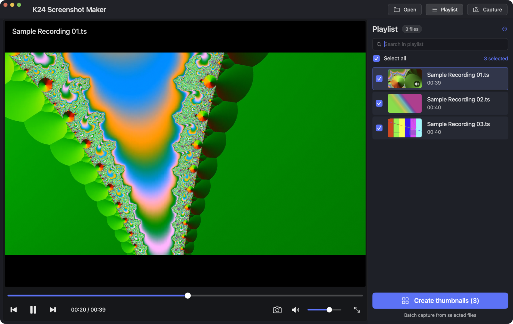

# K24 Screenshot Maker

macOS video player for TV recordings (`.ts`) with batch thumbnail (contact) sheets.



**Current version: 1.1** ([release notes](https://github.com/27sec/K24-Screenshot-Maker/releases/tag/v1.1))

### New in 1.1
- Full screen: translucent bars float over the video and hide when the mouse is idle.
- Option to open the playlist at launch or keep it hidden.
- Drop files on the video to play them now, or on the playlist to queue them.

## Requirements
- macOS 15+
- ffmpeg and mpv: `brew install ffmpeg mpv`
  (libmpv is loaded at runtime from Homebrew for playback; ffmpeg does frame capture and sheets)

## Download
1. Install the requirements above: `brew install ffmpeg mpv`
2. Download the latest `K24-Screenshot-Maker-*-arm64.zip` from
   [Releases](https://github.com/27sec/K24-Screenshot-Maker/releases/latest) (Apple Silicon only).
3. Unzip it and move **K24 Screenshot Maker.app** to `/Applications`.
4. The app is ad-hoc signed, not notarized, so macOS blocks the first launch.
   Right-click the app → **Open**, or run:
   ```bash
   xattr -dr com.apple.quarantine "/Applications/K24 Screenshot Maker.app"
   ```

To update, quit the app and replace the copy in `/Applications` with the new one.
Your settings (save folder, sheet options, volume, playlist at launch) are kept.

## Build from source
```bash
./build_app.sh
./build_app.sh --install   # builds and moves the app to /Applications
```

## Usage

### Playing
- **Open** (⌘O) to choose `.ts` files or a folder, or drag them into the window:
  - drop on the **video** to play right away
  - drop on the **playlist** to add them to the end of the queue
- Click a row in the playlist to play it.
- Playback uses libmpv, so `.ts` files (H.264, HEVC, MPEG-2, AC-3/MP2 audio) play immediately
  with no conversion. Interlaced recordings are deinterlaced automatically.

### Full screen
- Double-click the video or use the full-screen button.
- The title bar, controls and playlist float translucent over the video and hide after a few
  seconds. Move the mouse to bring them back; they stay up while the pointer is over them.

### Playlist
- **Playlist** button or ⌥⌘L shows or hides it.
- **View → Show Playlist at Launch** (also in the playlist's ⋯ menu) sets whether it is open
  when the app starts.

### Capture and thumbnail sheets
- **Capture** saves the current frame as PNG to the Save-to folder.
- Tick files (or **Select all**) → **Create thumbnails (N)** → choose layout
  3×3 / 3×4 / 4×4 / 4×5 / 5×5,
  capture mode, JPEG/PNG, width → **Generate**. Output: `<name>_sheet.jpg` (or `.png`).

### Keyboard shortcuts
| Key | Action |
| --- | --- |
| Space | Play / pause |
| ← / → or ⌘← / ⌘→ | Seek back / forward 10 s |
| ⌘O | Open files or a folder |
| ⌥⌘L | Show / hide playlist |
| ⇧⌘S | Capture frame |
| ⇧⌘T | Create thumbnail sheets |

Headless: `FramePlayer --sheet <video> <outdir> [3x4]`

## License
MIT, see [LICENSE](LICENSE). The bundled mpv headers in `Sources/CMpv/include` are ISC licensed.
